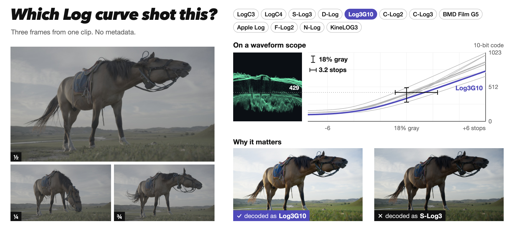

<div align="center">

# CameraLogBench

**Can multimodal models identify a camera's Log curve from video frames?**

[![arXiv][badge-arxiv]](https://arxiv.org/abs/2611.32172)
[![Hugging Face dataset][badge-hf]](https://huggingface.co/datasets/mediatech-tech/MediaStormBench/tree/main/CameraLogBench)
[![Leaderboard][badge-site]](https://tech.ysjf.com/mediastormbench/)
[![License][badge-license]](LICENSE)
[![GitHub stars][badge-stars]](https://github.com/MediaStorm-Tech/MediaStormBench/stargazers)

[Install](#install) · [Data](#download-the-data) · [Evaluate](#run-an-evaluation) · [Score](#score) · [Results](#results) · [Citation](#citation)



</div>

Code for the paper [*MediaStormBench-CameraLog: Can Multimodal Models Identify a Camera's Log Curve?*](https://arxiv.org/abs/2611.32172)

CameraLogBench asks a multimodal model which Log encoding (transfer function and native gamut) a piece of
camera footage was recorded in, given only frames of the clip and no metadata. The main test set is real
professional footage; around it, a set of controls derived from the published vendor formulas separates
content priors from actual photometric measurement: graded "not Log" negatives, synthetic frames in which
only the curve changes, synthetic and photographed colour charts, re-encodes of one frame with every curve,
specification digests given in context and a training-free formula baseline.

CameraLogBench is the first released subset of **MediaStormBench**, MediaStorm's benchmark for AI in its own
production workflows; each subset takes one need from day-to-day production and turns it into a test.

## Install

Python 3.10 or newer. ffmpeg is not needed on the system (`imageio-ffmpeg` ships a binary).

```bash
git clone https://github.com/MediaStorm-Tech/MediaStormBench
cd MediaStormBench/CameraLogBench
python -m venv .venv && source .venv/bin/activate
pip install -r requirements.txt
python -m pytest -q
```

Run the commands below from the `CameraLogBench/` folder. To use the package from another project without
cloning:

```bash
pip install "git+https://github.com/MediaStorm-Tech/MediaStormBench.git#subdirectory=CameraLogBench"
```

## Download the data

```bash
hf download mediatech-tech/MediaStormBench --repo-type dataset \
    --include "CameraLogBench/*" --exclude "CameraLogBench/videos/*" --local-dir data
```

gives `data/CameraLogBench/` with the questions, answers and frames (about 3 GB). The original videos (330
clips, about 276 GB) are left out; drop `--exclude` to download them too.

The dataset has one annotation file per subset, `annotations/<subset>.jsonl`, with paths relative to the
dataset root:

| subset | content |
|---|---|
| `real` | real Log clips (three frames each) and graded "not Log" negatives |
| `real_chart` | photographed colour charts |
| `synth_scene` | synthetic natural scenes: scene-linear HDR images encoded with every curve |
| `synth_chart` | synthetic colour charts |
| `reencode` | real frames decoded and re-encoded with every curve |

One question per line:

```json
{"item_id": "R0001__curve", "clip_id": "R0001", "task": "curve",
 "input": {"image_webp": "frames/real/R0001/p50.webp",
           "frames_webp": ["frames/real/R0001/p25.webp", "frames/real/R0001/p50.webp", "frames/real/R0001/p75.webp"],
           "frame_positions": ["p25", "p50", "p75"]},
 "options": ["arri_logc3", "arri_logc4", "..."],
 "gold": {"primary": "...", "accept": ["..."], "brand": "...", "gamut_id": "...", "camera_model": "..."},
 "twin_of": null, "meta": {"subset": "real", "source_class": "..."}}
```

Tasks: `curve` (which encoding), `camera` (which brand) and `curve_absent` (the same frames with the
correct option removed; the right answer is "Cannot be determined"). Frames are 1920 px wide, 8-bit,
lossless WebP, with no LUT, colour transform or ICC profile applied. Single-image subsets have only
`input.image_webp`.

## Run an evaluation

The runner talks to any OpenAI-compatible `/chat/completions` endpoint. Claude models run with `--effort`
go through the native Anthropic Messages API (adaptive thinking), as in the paper.

```bash
export OPENAI_BASE_URL=https://api.openai.com/v1     # or any OpenAI-compatible gateway (include /v1)
export OPENAI_API_KEY=...
export ANTHROPIC_API_KEY=...                         # only for claude-* models; ANTHROPIC_BASE_URL is optional

# real footage, the paper's settings: three frames per request, two option orders, high reasoning effort
python -m cameralogbench.eval.runner \
    --annotations data/CameraLogBench/annotations/real.jsonl --data-root data/CameraLogBench \
    --models gpt-6.1-sol --tiers zero_shot with_reference --frames k3 \
    --rotations 2 --effort high --max-tokens 32000 --out runs/real__gpt-6.1-sol.jsonl

# synthetic charts: single image, all three tiers
python -m cameralogbench.eval.runner \
    --annotations data/CameraLogBench/annotations/synth_chart.jsonl --data-root data/CameraLogBench \
    --models gpt-6.1-sol --tiers zero_shot with_spec with_reference \
    --rotations 2 --effort high --max-tokens 32000 --out runs/synth_chart__gpt-6.1-sol.jsonl
```

- Tiers: `text_only` (no image), `zero_shot` (frames only), `with_spec` (frames + the vendors'
  specifications), `with_reference` (frames + specifications + a measurement guide). The digests are in
  `cameralogbench/reference/`; the released questions use `digest_ext2_spec.md` and `digest_ext2.md`, which
  cover all 17 options.
- `--frames k3` sends the three frames of a clip in one request; `single` sends the middle frame; `each`
  sends one request per frame. Single-image subsets always use their one image.
- `--rotations 2` asks every question in two option orders (CircularEval).
- The output file is append-only and resumable: rerunning the same command only sends calls that have no
  successful record yet. Unparsable answers count as wrong and are not re-asked unless
  `--retry-parse-failures` is given.
- `--dry-run` sends nothing and writes fake answers, to check the pipeline.

## Score

```bash
python -m cameralogbench.eval.score \
    --annotations data/CameraLogBench/annotations/real.jsonl \
    --results 'runs/real__*.jsonl' --report runs/real_report
```

writes `runs/real_report.md` and `.csv`: accuracy, top-2 accuracy, accuracy over both option orders,
abstention on `curve_absent`, per-class accuracy, confusion matrices, position-bias checks and sample
answers. Every call counts: API errors and unparsable answers are wrong. Items whose clip is DJI D-Log M
(no published formula) are left out by default; it stays an answer option.

## Baselines and tools

| module | what it does |
|---|---|
| `cameralogbench.evidence` | training-free formula baseline: assumes each candidate curve in turn and checks black level, decoded negatives, out-of-locus colours, exposure and clip level |
| `cameralogbench.synth` | synthetic charts, natural scenes from scene-linear HDR images, and re-encodes |
| `cameralogbench.graded` | turns a Log frame into a display-referred "not Log" frame (three looks) |
| `cameralogbench.frames` | extracts the model input from your own videos and writes annotations from a `labels.csv` |
| `cameralogbench.curves` | all transfer functions, gamuts, expected code values and the digest generator |

```bash
# formula baseline on the released frames (results in runner format, scored by eval.score)
python -m cameralogbench.evidence --annotations data/CameraLogBench/annotations/real.jsonl \
    --data-root data/CameraLogBench --out runs/real__formula.jsonl
# the synthetic charts with the patch positions known
python -m cameralogbench.evidence --annotations data/CameraLogBench/annotations/synth_chart.jsonl \
    --data-root data/CameraLogBench --patches synth_chart --out runs/synth_chart__formula.jsonl

# your own footage: frames + annotations, then the runner as above with --data-root work/mydata
python -m cameralogbench.frames --videos path/to/clips --labels labels.csv --out-root work/mydata --subset mine
```

The paper's formula-baseline numbers were computed on 16-bit frames, which are not part of the release; on
the released 8-bit frames the baseline gives close but not identical numbers.

## Answer options

The curve question lists 17 options in this order; the probe question (`curve_absent`) lists the same options
without the correct one, 16 in all:

| id | option text | curve |
|---|---|---|
| `arri_logc3` | ARRI LogC3 / ALEXA Wide Gamut (AWG3) | ARRI LogC3 |
| `arri_logc4` | ARRI LogC4 / ALEXA Wide Gamut 4 (AWG4) | ARRI LogC4 |
| `sony_slog3` | Sony S-Log3 / S-Gamut3.Cine | Sony S-Log3 |
| `dji_dlog` | DJI D-Log / D-Gamut | DJI D-Log |
| `dji_dlogm` | DJI D-Log M | no published formula; excluded from scoring as ground truth |
| `red_log3g10` | RED Log3G10 / REDWideGamutRGB | RED Log3G10 |
| `canon_clog2` | Canon C-Log2 / Cinema Gamut | Canon Log 2 |
| `canon_clog3` | Canon C-Log3 / Cinema Gamut | Canon Log 3 |
| `bmd_film_gen5` | Blackmagic Film Gen 5 / Blackmagic Wide Gamut Gen 5 | Blackmagic Film Gen 5 |
| `apple_log` | Apple Log / Rec.2020 | Apple Log |
| `apple_log2` | Apple Log 2 / Apple Wide Gamut | Apple Log curve, wider gamut |
| `fuji_flog2` | Fujifilm F-Log2 / F-Gamut (Rec.2020 primaries) | Fujifilm F-Log2 |
| `fuji_flog2c` | Fujifilm F-Log2 C / F-Gamut C | F-Log2 curve, wider gamut |
| `nikon_nlog` | Nikon N-Log / Rec.2020 | Nikon N-Log |
| `kine_log3` | Kinefinity KineLOG3 / Kinefinity Wide Gamut | Kinefinity KineLOG3 |
| `not_log` | Not a Log encoding (already display-referred, e.g. Rec.709 / sRGB) | |
| `undetermined` | Cannot be determined from this image | |

These are 15 encodings built on 12 official curves with a published vendor formula, plus D-Log M. The brand
question lists ARRI, Sony, DJI, RED, Canon, Blackmagic Design, Apple, Fujifilm, Nikon, Kinefinity and
"Cannot be determined".

## Results

Accuracy on the curve question, frames only, every question asked in two option orders. Real footage is
the share of correct answers on the real Log clips; the two chart columns are averaged over encodings. The
clips are not balanced across curves, so always answering DJI D-Log, the most frequent curve, already scores
0.164.

| model | real footage | real charts | synthetic charts |
|---|---:|---:|---:|
| Gemini 4 Carbon | 0.259 | 0.271 | 0.190 |
| Gemini 3.8 Flash | 0.200 | 0.221 | 0.190 |
| Kimi K3.1 Pro | 0.196 | 0.174 | 0.220 |
| Qwen4-Max | 0.192 | 0.128 | 0.050 |
| Gemini 3.1 Pro | 0.188 | 0.212 | 0.140 |
| Kimi K3 | 0.182 | 0.083 | 0.150 |
| Claude Sonnet 5.5 | 0.153 | 0.042 | 0.300 |
| DeepSeek-V4.1-Flash | 0.145 | 0.053 | 0.080 |
| GPT-6.1 Sol | 0.142 | 0.221 | 0.460 |
| Qwen3.8-Flash | 0.139 | 0.032 | 0.090 |
| GPT-6 Astra | 0.138 | 0.296 | 0.390 |
| Claude Opus 5.5 | 0.130 | 0.042 | 0.420 |
| Qwen3.8-Max | 0.058 | 0.024 | 0.050 |
| Random guess | 0.059 | 0.059 | 0.059 |
| Always DJI D-Log | 0.164 | – | – |

The paper reports these settings and many more (specifications in context, probes, re-encodes, per-curve
results); the [website](https://tech.ysjf.com/mediastormbench/) keeps the leaderboard up to date.

## Evaluated models

| model | id |
|---|---|
| Claude Opus 5.5 | `claude-opus-5-5` |
| Claude Sonnet 5.5 | `claude-sonnet-5-5` |
| GPT-6.1 Sol | `gpt-6.1-sol` |
| GPT-6 Astra | `gpt-6-astra` |
| Gemini 4 Carbon | `gemini-4-carbon` |
| Gemini 3.1 Pro | `gemini-3.1-pro-preview` |
| Gemini 3.8 Flash | `gemini-3.8-flash` |
| Qwen4-Max | `qwen4-max` |
| Qwen3.8-Max | `qwen3.8-max` |
| Qwen3.8-Flash | `qwen3.8-flash` |
| Kimi K3.1 Pro | `kimi-k3.1-pro` |
| Kimi K3 | `kimi-k3` |
| DeepSeek-V4.1-Flash | `deepseek-v4.1-flash` |

All were run with `--effort high`. Model ids differ between providers; pass the id your endpoint uses.
Per-model request parameters (token-limit field, temperature) are in
`cameralogbench.eval.runner.request_params` and are stored with every result.

## Citation

```bibtex
@misc{cameralogbench2026,
  title  = {MediaStormBench-CameraLog: Can Multimodal Models Identify a Camera's Log Curve?},
  author = {Ma, Ming and Hu, Wenhao and Wang, Qichao and Wang, Yuhao and Zhao, Junpeng and Wang, Qiyi and Zhang, Fangrui and Lai, Zhiqian and Guan, Shanxin and Pei, Haoyi and Chen, Hongan and Gong, Rui},
  year   = {2026},
  note   = {arXiv preprint arXiv:2611.32172}
}
```

## Contact

Questions and issues: open a GitHub issue or write to research@ysjf.com.

## License

The code is released under the Apache License 2.0 (see `LICENSE`). The dataset on Hugging Face has its own
license; see its dataset card.

[badge-arxiv]: https://img.shields.io/badge/arXiv-2611.32172-b31b1b?logo=arxiv&logoColor=white
[badge-hf]: https://img.shields.io/badge/Hugging%20Face-Dataset-FFD21E?logo=huggingface
[badge-site]: https://img.shields.io/badge/Website-Leaderboard-CB1A2A?logo=data%3Aimage%2Fsvg%2Bxml%3Bbase64%2CPHN2ZyB4bWxucz0iaHR0cDovL3d3dy53My5vcmcvMjAwMC9zdmciIHZpZXdCb3g9IjAgMCAxMDAgMTAwIj48cGF0aCBmaWxsPSIjZmZmIiBkPSJtNTAsNkMyNS43LDYsNiwyNS43LDYsNTBzMTkuNyw0NCw0NCw0NCw0NC0xOS43LDQ0LTQ0Uzc0LjMsNiw1MCw2Wk0xMi41OCw0OS45N2MwLTIwLjY3LDE2Ljc2LTM3LjQyLDM3LjQyLTM3LjQyLDUuNjQsMCwxMC45OCwxLjI1LDE1Ljc3LDMuNDgsMi41Niw1LjQsNy40NSwxNi40OSw5LjAxLDI1LjUxLjgyLDQuOTIuNDcsOS4wMi0uMjcsMTIuMi4xOC0xLjIyLjI4LTIuNDYuMjgtMy43MywwLTEzLjY5LTExLjEtMjQuNzktMjQuNzktMjQuNzktNy41NCwwLTE0LjI5LDMuMzctMTguODQsOC42OC0zLjk5LDQuMTUtOC40MSwxMS42NS04Ljc0LDIyLjYxLS4yLDYuNzIuNjMsMTQuNjUsMS4zOSwyMC4xOS02LjkzLTYuNzktMTEuMjMtMTYuMjYtMTEuMjMtMjYuNzJabTI1Ljg1LjAzYzAsNC4yNiwyLjMxLDcuOTcsNS43NCw5Ljk5LDIuMDIsMS4zMiw1LjI1LDMuMTIsNy41LDMuMyw1LjYzLjQ2LDEwLjgtLjg5LDE0LjY0LTIuNi0zLjQ5LDUuMjYtOS40Niw4LjczLTE2LjI0LDguNzMtOC40MiwwLTE1LjYtNS4zNS0xOC4zMS0xMi44NC0uMzMtMy45OS4wOC0xMC4yMiw0Ljk0LTE0LjExLDUuNDgtNC4zOCw5LjkxLTQuMzMsMTEuOTYtMy45Ni01Ljc2LjY3LTEwLjIzLDUuNTYtMTAuMjMsMTEuNDlabTI0LjQ2LDcuOWMtNC45NiwzLjgyLTkuMzksMy45MS0xMS42MywzLjYsNS44LS42MywxMC4zMi01LjU0LDEwLjMyLTExLjUxLDAtMy44OS0xLjkyLTcuMzItNC44Ni05LjQyLjAyLDAsLjA1LjAxLjA0LjAxLTEuNi0xLjE3LTUuNDYtMy4zOS03LjY4LTMuNzQtNS41Ni0uODgtMTEuMzUuNjktMTUuNDYsMi42NCwzLjQ2LTUuNDMsOS41Mi05LjAzLDE2LjQzLTkuMDMsOC40NCwwLDE1LjYyLDUuMzYsMTguMzIsMTIuODcuMiwzLjktLjMzLDEwLjU5LTUuNSwxNC41N1ptLTEyLjg4LDI5LjQ5Yy01LjUyLDAtMTAuNzYtMS4yLTE1LjQ4LTMuMzQtMi42OC01LjQyLTcuNzQtMTYuNDctOS4yOS0yNS40NS0uOC00LjgtLjQ4LTguODIuMjEtMTEuOTYtLjE1LDEuMS0uMjMsMi4yMi0uMjMsMy4zNSwwLDEzLjY5LDExLjEsMjQuNzksMjQuNzksMjQuNzksOC4xOCwwLDE1LjQzLTMuOTYsMTkuOTUtMTAuMDcsMy42NC00LjM1LDcuMzUtMTEuMzUsNy42NC0yMS4wOS4yMS02LjgtLjYtMTQuNzktMS4zMi0yMC4zMiw2Ljg5LDYuNzksMTEuMTYsMTYuMjIsMTEuMTYsMjYuNjUsMCwyMC42Ny0xNi43NiwzNy40Mi0zNy40MiwzNy40MloiLz48L3N2Zz4%3D
[badge-license]: https://img.shields.io/badge/License-Apache--2.0-blue
[badge-stars]: https://img.shields.io/github/stars/MediaStorm-Tech/MediaStormBench?style=social
