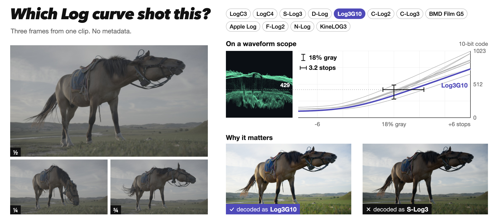

<div align="center">

<picture>
  <source media="(prefers-color-scheme: dark)" srcset="assets/mediastorm_logo_dark.svg">
  
</picture>

# MediaStormBench

**MediaStorm's benchmark for AI in its own production workflows**

[![arXiv][badge-arxiv]](https://arxiv.org/abs/2611.32172)
[![Hugging Face dataset][badge-hf]](https://huggingface.co/datasets/mediatech-tech/MediaStormBench)
[![Leaderboard][badge-site]](https://tech.ysjf.com/mediastormbench/)
[![License][badge-license]](LICENSE)
[![GitHub stars][badge-stars]](https://github.com/MediaStorm-Tech/MediaStormBench/stargazers)

</div>

Each subset takes one need from day-to-day production and turns it into a test. Every subset lives in its own
folder with its own code, README and install instructions; the data is on Hugging Face.

| Subset | Question |
|---|---|
| [**CameraLogBench**](#cameralogbench) | Can multimodal models identify a camera's Log curve from video frames? |

## News

- **2026-11-25** CameraLogBench, the first subset, is released: [paper](https://arxiv.org/abs/2611.32172), [code](CameraLogBench/), [dataset](https://huggingface.co/datasets/mediatech-tech/MediaStormBench/tree/main/CameraLogBench) and [leaderboard](https://tech.ysjf.com/mediastormbench/).

## CameraLogBench

<a href="CameraLogBench/"></a>

Cameras record Log footage by compressing a wide range of scene light into pixel code values with a
vendor-defined logarithmic curve, and color can be restored correctly in post-production only once that curve
is known. The curve, however, is recorded only in file metadata, which is easily lost in transcoding and in
hand-offs between teams.

**CameraLogBench** asks a multimodal model which Log encoding (transfer function and native gamut) a piece of
camera footage was recorded in, given only frames of the clip and no metadata. The main test set is real
professional footage: **330 Log clips** from **20 camera bodies**, covering **12 official curves**. Around it,
a set of controls derived from the published vendor formulas separates content priors from actual photometric
measurement: graded "not Log" negatives, synthetic frames in which only the curve changes, synthetic and
photographed color charts, re-encodes of one frame with every curve, specification digests given in context
and a training-free formula baseline.

Code and full instructions: [`CameraLogBench/`](CameraLogBench/).

### Dataset

| Part | Images | Questions | Content |
|---|---|---|---|
| `real` | 407 clips × 3 frames | 1,067 | 330 real Log clips from 20 camera bodies covering all 12 official curves (13 curve / gamut encodings) and 77 graded negatives (the same footage graded to a display look, answer *not Log*) |
| `real_chart` | 30 | 30 | Real frames of standard color charts shot in Log on 10 camera bodies (12 encodings) |
| `synth_scene` | 600 | 710 | Synthetic natural scenes: 100 public HDR scenes encoded with the official formulas, 50 images for each of 11 curves, plus 50 non-Log versions |
| `synth_chart` | 53 | 53 | Synthetic ColorChecker charts encoded with each official curve at several exposures |
| `reencode` | 84 | 84 | Six real frames inverted to scene light and re-encoded with every official curve: identical content, different answers |

Every question is multiple choice. `curve` asks for the Log encoding (17 options), `camera` for the brand, and
the probe `curve_absent` shows the same frames with the correct option removed, so the right answer is "Cannot
be determined". Each real clip is given as three frames taken at 25%, 50% and 75% of its duration; all frames
are 1920 px wide, 8-bit, lossless WebP. The original 3840×2160 10-bit ProRes recordings are in the dataset as
well. Format and scoring are described in the
[dataset card](https://huggingface.co/datasets/mediatech-tech/MediaStormBench/blob/main/CameraLogBench/README.md).

### Leaderboard

Accuracy on the curve question, frames only, every question asked in two option orders. Real footage is the
share of correct answers on the real Log clips; the two chart columns are averaged over encodings. The clips
are not balanced across curves, so always answering DJI D-Log, the most frequent curve, already scores 0.164.

| model | real footage | real charts | synthetic charts |
|---|---:|---:|---:|
| Gemini 4 Carbon | 0.259 | 0.271 | 0.190 |
| Gemini 3.8 Flash | 0.200 | 0.221 | 0.190 |
| Kimi K3.1 Pro | 0.196 | 0.174 | 0.220 |
| Qwen4-Max | 0.192 | 0.128 | 0.050 |
| Gemini 3.1 Pro | 0.188 | 0.212 | 0.140 |
| Kimi K3 | 0.182 | 0.083 | 0.150 |
| Claude Sonnet 5.5 | 0.153 | 0.042 | 0.300 |
| DeepSeek-V4.1-Flash | 0.145 | 0.053 | 0.080 |
| GPT-6.1 Sol | 0.142 | 0.221 | 0.460 |
| Qwen3.8-Flash | 0.139 | 0.032 | 0.090 |
| GPT-6 Astra | 0.138 | 0.296 | 0.390 |
| Claude Opus 5.5 | 0.130 | 0.042 | 0.420 |
| Qwen3.8-Max | 0.058 | 0.024 | 0.050 |
| Random guess | 0.059 | 0.059 | 0.059 |
| Always DJI D-Log | 0.164 | – | – |

The paper reports these settings and many more (specifications in context, probes, re-encodes, per-curve
results); the [website](https://tech.ysjf.com/mediastormbench/) keeps the leaderboard up to date.

### Quick start

```bash
git clone https://github.com/MediaStorm-Tech/MediaStormBench
cd MediaStormBench/CameraLogBench
pip install -r requirements.txt

# questions, answers and frames (about 3 GB; the original videos are left out)
hf download mediatech-tech/MediaStormBench --repo-type dataset \
    --include "CameraLogBench/*" --exclude "CameraLogBench/videos/*" --local-dir data

# real footage, frames only: three frames per request, two option orders, high reasoning effort
# (any OpenAI-compatible endpoint)
export OPENAI_BASE_URL=https://api.openai.com/v1
export OPENAI_API_KEY=...
python -m cameralogbench.eval.runner \
    --annotations data/CameraLogBench/annotations/real.jsonl --data-root data/CameraLogBench \
    --models gpt-6.1-sol --tiers zero_shot --frames k3 \
    --rotations 2 --effort high --max-tokens 32000 --out runs/real__gpt-6.1-sol.jsonl

# score it
python -m cameralogbench.eval.score \
    --annotations data/CameraLogBench/annotations/real.jsonl \
    --results 'runs/real__*.jsonl' --report runs/real_report
```

The other test sets, the settings with specifications in context, the formula baseline and the tools for your
own footage are in [CameraLogBench/README.md](CameraLogBench/README.md).

## Citation

```bibtex
@misc{cameralogbench2026,
  title  = {MediaStormBench-CameraLog: Can Multimodal Models Identify a Camera's Log Curve?},
  author = {Ma, Ming and Hu, Wenhao and Wang, Qichao and Wang, Yuhao and Zhao, Junpeng and Wang, Qiyi and Zhang, Fangrui and Lai, Zhiqian and Guan, Shanxin and Pei, Haoyi and Chen, Hongan and Gong, Rui},
  year   = {2026},
  note   = {arXiv preprint arXiv:2611.32172}
}
```

## Contact

Open a GitHub issue or write to research@ysjf.com.

## License

Code in this repository is released under the Apache License 2.0 (see `LICENSE`). Each dataset has its own
license; see its dataset card.

[badge-arxiv]: https://img.shields.io/badge/arXiv-2611.32172-b31b1b?logo=arxiv&logoColor=white
[badge-hf]: https://img.shields.io/badge/Hugging%20Face-Dataset-FFD21E?logo=huggingface
[badge-site]: https://img.shields.io/badge/Website-Leaderboard-CB1A2A?logo=data%3Aimage%2Fsvg%2Bxml%3Bbase64%2CPHN2ZyB4bWxucz0iaHR0cDovL3d3dy53My5vcmcvMjAwMC9zdmciIHZpZXdCb3g9IjAgMCAxMDAgMTAwIj48cGF0aCBmaWxsPSIjZmZmIiBkPSJtNTAsNkMyNS43LDYsNiwyNS43LDYsNTBzMTkuNyw0NCw0NCw0NCw0NC0xOS43LDQ0LTQ0Uzc0LjMsNiw1MCw2Wk0xMi41OCw0OS45N2MwLTIwLjY3LDE2Ljc2LTM3LjQyLDM3LjQyLTM3LjQyLDUuNjQsMCwxMC45OCwxLjI1LDE1Ljc3LDMuNDgsMi41Niw1LjQsNy40NSwxNi40OSw5LjAxLDI1LjUxLjgyLDQuOTIuNDcsOS4wMi0uMjcsMTIuMi4xOC0xLjIyLjI4LTIuNDYuMjgtMy43MywwLTEzLjY5LTExLjEtMjQuNzktMjQuNzktMjQuNzktNy41NCwwLTE0LjI5LDMuMzctMTguODQsOC42OC0zLjk5LDQuMTUtOC40MSwxMS42NS04Ljc0LDIyLjYxLS4yLDYuNzIuNjMsMTQuNjUsMS4zOSwyMC4xOS02LjkzLTYuNzktMTEuMjMtMTYuMjYtMTEuMjMtMjYuNzJabTI1Ljg1LjAzYzAsNC4yNiwyLjMxLDcuOTcsNS43NCw5Ljk5LDIuMDIsMS4zMiw1LjI1LDMuMTIsNy41LDMuMyw1LjYzLjQ2LDEwLjgtLjg5LDE0LjY0LTIuNi0zLjQ5LDUuMjYtOS40Niw4LjczLTE2LjI0LDguNzMtOC40MiwwLTE1LjYtNS4zNS0xOC4zMS0xMi44NC0uMzMtMy45OS4wOC0xMC4yMiw0Ljk0LTE0LjExLDUuNDgtNC4zOCw5LjkxLTQuMzMsMTEuOTYtMy45Ni01Ljc2LjY3LTEwLjIzLDUuNTYtMTAuMjMsMTEuNDlabTI0LjQ2LDcuOWMtNC45NiwzLjgyLTkuMzksMy45MS0xMS42MywzLjYsNS44LS42MywxMC4zMi01LjU0LDEwLjMyLTExLjUxLDAtMy44OS0xLjkyLTcuMzItNC44Ni05LjQyLjAyLDAsLjA1LjAxLjA0LjAxLTEuNi0xLjE3LTUuNDYtMy4zOS03LjY4LTMuNzQtNS41Ni0uODgtMTEuMzUuNjktMTUuNDYsMi42NCwzLjQ2LTUuNDMsOS41Mi05LjAzLDE2LjQzLTkuMDMsOC40NCwwLDE1LjYyLDUuMzYsMTguMzIsMTIuODcuMiwzLjktLjMzLDEwLjU5LTUuNSwxNC41N1ptLTEyLjg4LDI5LjQ5Yy01LjUyLDAtMTAuNzYtMS4yLTE1LjQ4LTMuMzQtMi42OC01LjQyLTcuNzQtMTYuNDctOS4yOS0yNS40NS0uOC00LjgtLjQ4LTguODIuMjEtMTEuOTYtLjE1LDEuMS0uMjMsMi4yMi0uMjMsMy4zNSwwLDEzLjY5LDExLjEsMjQuNzksMjQuNzksMjQuNzksOC4xOCwwLDE1LjQzLTMuOTYsMTkuOTUtMTAuMDcsMy42NC00LjM1LDcuMzUtMTEuMzUsNy42NC0yMS4wOS4yMS02LjgtLjYtMTQuNzktMS4zMi0yMC4zMiw2Ljg5LDYuNzksMTEuMTYsMTYuMjIsMTEuMTYsMjYuNjUsMCwyMC42Ny0xNi43NiwzNy40Mi0zNy40MiwzNy40MloiLz48L3N2Zz4%3D
[badge-license]: https://img.shields.io/badge/License-Apache--2.0-blue
[badge-stars]: https://img.shields.io/github/stars/MediaStorm-Tech/MediaStormBench?style=social
